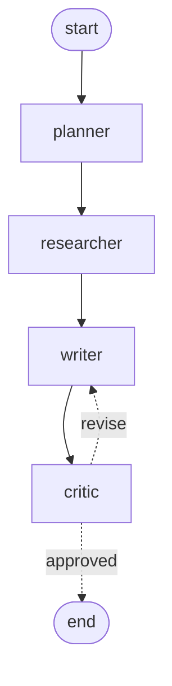

# 🤖 Multi-Agent Research Team

Give it any topic and a team of four AI agents researches the web and writes a report together, with an editor that sends drafts back until they're good enough.

Built with **LangGraph**, **LangChain** and **Pydantic**. Works with **any LLM provider** (Groq, OpenAI, Gemini, Claude, Ollama). Web search via DuckDuckGo needs no API key.

## 👥 The team
| Agent | Job |
|---|---|
| 🧭 **Planner** | Breaks the topic into 3–5 research questions (Pydantic `Plan`) |
| 🔎 **Researcher** | Searches the web for each question and summarises the findings |
| ✍️ **Writer** | Writes a structured markdown report from the notes, and revises it using feedback |
| 🧐 **Critic** | Scores the draft 1–10 (Pydantic `Review`); approves at 8+ or sends it back |

## 🔁 Workflow

The **critic → writer loop** is a LangGraph *conditional edge*. It stops when the critic approves, or after 2 revisions so it can't loop forever.

## 🚀 Run it
```bash
git clone https://github.com/varshith346/multi-agent-research-team.git
cd multi-agent-research-team
python -m venv venv
venv\Scripts\activate          # Windows  (Mac/Linux: source venv/bin/activate)
pip install -r requirements.txt
copy .env.example .env         # Windows  (Mac/Linux: cp .env.example .env)
# open .env, set LLM_PROVIDER and paste your API key
python main.py "How do electric car batteries work?"
```
The report prints in the terminal and is saved to `reports/`.

## 📁 Project structure
| File | What it does |
|---|---|
| `agents.py` | Shared state, the 4 agents, the routing function and the graph |
| `search.py` | Free DuckDuckGo web search |
| `main.py` | Command-line entry point; saves the report |
| `draw_graph.py` | Prints the graph as a Mermaid diagram |
| `llm.py` | Picks the LLM provider from `.env` |
